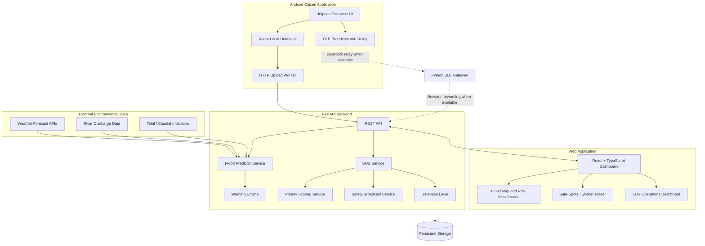

# ResQNet — AI-Powered Flood Intelligence & Emergency Response Platform

**Predict floods. Connect citizens. Prioritize rescue.**

ResQNet is a disaster-management and early-warning platform designed for flood-prone regions of Kerala and coastal Karnataka. It combines hydrometeorological intelligence, an interactive flood-monitoring dashboard, an Android emergency SOS application, and responder-side incident management.

The platform is designed to help authorities understand changing flood conditions, help citizens communicate distress, and organize emergency requests by priority. Its offline communication subsystem is designed to support store-and-forward Bluetooth relaying when conventional connectivity is disrupted.

> **Project status:** ResQNet is an experimental disaster-response decision-support platform. Its active Kerala flood engine uses multi-factor rules. Calibrated Coastal Karnataka machine-learning models are maintained separately as benchmark artifacts. Offline Bluetooth delivery depends on device compatibility, relay availability, and successful gateway reception.

---

## Table of Contents

- [Project Overview](#project-overview)
- [Core Features](#core-features)
- [System Architecture](#system-architecture)
- [End-to-End Data Flow](#end-to-end-data-flow)
- [Technology Stack](#technology-stack)
- [Repository Structure](#repository-structure)
- [Flood Intelligence Engine](#flood-intelligence-engine)
- [Android SOS and Offline Communication](#android-sos-and-offline-communication)
- [Responder Dashboard](#responder-dashboard)
- [Prerequisites](#prerequisites)
- [Installation and Setup](#installation-and-setup)
- [Running the Application](#running-the-application)
- [Testing](#testing)
- [Data Sources](#data-sources)
- [Security and Responsible Use](#security-and-responsible-use)
- [Current Limitations and Future Work](#current-limitations-and-future-work)

---

## Project Overview

Flood emergencies create two major challenges:

1. **Early awareness:** Heavy rainfall, river discharge, saturated soil, and coastal backwater conditions can combine to create dangerous flooding.
2. **Emergency communication:** Citizens may lose mobile connectivity during disasters, while rescue teams must prioritize and coordinate numerous distress requests.

ResQNet addresses these challenges through three connected capabilities.

| Component | Purpose |
|---|---|
| Flood Intelligence | Evaluates hydrometeorological indicators and generates flood-risk information and warnings. |
| Citizen SOS Application | Lets citizens create emergency requests, retain information locally, and use Bluetooth relay capabilities where supported. |
| Responder Operations | Displays incidents, supports priority-based triage, and helps responders manage emergency requests. |

### Target regions

**Kerala — active operational dashboard**

Designed to cover all 14 revenue districts, with a rule-based flood intelligence engine using rainfall classifications and available river and weather indicators.

**Coastal Karnataka — preserved model benchmark**

Maintains historical machine-learning artifacts and evaluation data associated with coastal flood-risk research. This benchmark is distinct from the active Kerala rule engine.

---

## Core Features

### 1. Flood intelligence and early warning

- Weather forecasts and environmental indicators.
- Multi-factor flood-risk evaluation.
- Rainfall, river-discharge, soil-saturation, and coastal backwater indicators where supported by the configured data sources.
- Configurable warning thresholds.
- Duplicate-alert suppression and warning cooldown logic.
- Interactive risk visualization and rainfall trends.
- Development-only scenario simulation for testing hypothetical conditions.

### 2. Citizen Android SOS application

- Android application developed with Kotlin and Jetpack Compose.
- SOS creation and incident history.
- Local persistence using Room.
- Location and device-status information where permissions and hardware allow.
- Network upload capabilities when connectivity is available.
- Bluetooth Low Energy broadcasting and relay components.
- Safety-check interface for citizen responses.

### 3. Offline store-and-forward communication

The intended communication flow is:

1. A citizen creates an SOS request.
2. The request is retained locally.
3. A nearby compatible device may receive and relay the SOS using Bluetooth.
4. The message can travel across relay devices.
5. A gateway receives the packet and forwards it to the backend when network connectivity is available.

This architecture aims to improve resilience during connectivity failures. Successful end-to-end delivery is not guaranteed merely because a packet is stored or broadcast; relay and gateway behavior must be verified in physical-device tests.

### 4. Intelligent SOS triage

- Rule-based scoring of incoming distress requests.
- Priority categories and incident explanations.
- Negation-aware text rules.
- Time-based escalation for eligible unserviced incidents.
- Ranked SOS queues for responder attention.

The priority-scoring service is an explainable rule engine, not a trained machine-learning model.

### 5. Responder operations dashboard

- Flood intelligence and risk visualization.
- Interactive maps.
- Safe-Spots and relief-camp discovery.
- SOS incident monitoring.
- Priority-based incident queues.
- Incident assignment and lifecycle management where supported by the backend.
- SOS messaging and acknowledgement endpoints.

### 6. Safety broadcasts

The Android application includes a safety-check interface intended to support citizen responses to emergency coordination messages. The reach and reliability of broadcasts during offline conditions depend on the underlying communication path and require appropriate testing.

---

## System Architecture

ResQNet uses a modular architecture with a React web frontend, a Python FastAPI backend, and a separate Android application.



**Architecture notes**

- The web frontend communicates with the backend through HTTP APIs.
- Flood prediction and warning evaluation are backend responsibilities.
- SOS priority scoring and incident management are handled by backend services.
- The Android app maintains local SOS data and includes separate network and Bluetooth components.
- The BLE gateway is a bridge between supported Bluetooth packet reception and backend delivery.
- Flood intelligence, mobile SOS communication, and responder operations are distinct modules connected through defined interfaces.

The diagram describes the intended component relationships. Actual runtime behavior depends on configuration, available integrations, and tested interfaces.

---

## End-to-End Data Flow

### Flood intelligence flow

1. Environmental data is obtained from configured data providers.
2. The prediction service evaluates available hydrometeorological indicators.
3. The warning engine applies configured thresholds and suppression rules.
4. The backend exposes relevant information through its API.
5. The frontend displays risk information, maps, and warning indicators.

### SOS flow with internet access

1. A citizen creates an SOS request in the Android application.
2. The application retains the request locally.
3. The network upload component attempts to send the request to the backend.
4. The backend processes and stores the incident.
5. The priority-scoring service evaluates the available incident information.
6. The responder dashboard displays the incident and its priority.

### SOS flow without internet access

1. The citizen's device stores the SOS locally.
2. BLE broadcasting or relay components attempt to share the message with nearby compatible devices.
3. Relay devices can retain and forward messages according to their implemented behavior.
4. A reachable gateway receives a supported packet.
5. The gateway attempts backend delivery when connectivity becomes available.

The offline path requires physical-device validation. Bluetooth range, background execution restrictions, permissions, radio scheduling, and gateway availability can affect delivery.

---

## Technology Stack

| Layer | Technologies | Purpose |
|---|---|---|
| Web frontend | React 19, TypeScript, Vite | Dashboard and user interface |
| Mapping | Leaflet, GeoJSON | Interactive maps and geographic overlays |
| Charts | Recharts | Rainfall and risk visualizations |
| Backend | Python, FastAPI | REST API and application services |
| Data validation | Pydantic / FastAPI schemas | Request and response validation |
| Persistence | SQLAlchemy, SQLite configuration | Backend database access and persistence |
| Android development | Android Studio, Kotlin | Mobile application development |
| Android UI | Jetpack Compose | Native Android screens |
| Android local storage | Room | Local SOS persistence |
| Android background/network work | WorkManager components where configured | Deferred upload and background processing |
| Short-range communication | Bluetooth Low Energy | SOS broadcasting and relay components |
| Build tooling | Gradle, Android Gradle Plugin | Android compilation and packaging |
| Testing | pytest, Android unit tests, frontend production build | Verification of individual components and builds |
| Version control | Git, GitHub | Source control and collaboration |
| External data | Open-Meteo, Copernicus GloFAS, configured tidal data sources | Environmental data inputs |

**Development tools**

- **Visual Studio Code or another editor:** Web and Python development.
- **Android Studio:** Android SDK management, emulator/device debugging, Logcat, and Gradle builds.
- **PowerShell:** Running backend, frontend, gateway, and build commands on Windows.
- **Git and GitHub:** Version control and source hosting.

Tools listed as development environments are not necessarily runtime dependencies. Exact package versions are defined in the project manifests and Gradle configuration.

---

## Repository Structure

```text
ResQnet/
├── backend/
│   ├── app/
│   │   ├── api/
│   │   │   └── routes.py
│   │   ├── database/
│   │   │   ├── connection.py
│   │   │   └── models.py
│   │   ├── schemas/
│   │   │   └── sos.py
│   │   ├── services/
│   │   │   ├── predictor_service.py
│   │   │   ├── warning_engine.py
│   │   │   ├── priority_scoring_service.py
│   │   │   ├── sos_service.py
│   │   │   └── safety_broadcast_service.py
│   │   └── main.py
│   ├── scripts/
│   │   └── ble_gateway.py
│   ├── tests/
│   └── requirements.txt
│
├── frontend/
│   ├── public/
│   │   └── data/
│   ├── src/
│   │   ├── components/
│   │   ├── services/
│   │   ├── data/
│   │   └── App.tsx
│   ├── package.json
│   └── vite.config.ts
│
├── sos/
│   ├── mobile/
│   │   ├── app/
│   │   │   └── src/
│   │   │       ├── main/
│   │   │       └── test/
│   │   ├── gradle/
│   │   ├── build.gradle.kts
│   │   └── settings.gradle.kts
│   └── protocol/
│
├── data/
│   ├── source/
│   └── cleaned/
│
├── ml/
│   └── artifacts/
│
├── docs/
│   ├── architecture.md
│   ├── data-sources.md
│   ├── model-card.md
│   ├── integration-plan.md
│   └── coastal_flood_intelligence_report.md
│
├── README.md
└── .gitignore
```

This is a representative layout of the major modules; consult the repository for the exact current file list.

---

## Flood Intelligence Engine

### Kerala operational engine

The active Kerala dashboard uses a multi-factor, rule-based prediction approach.

The described inputs include:

- Forecast rainfall and accumulated rainfall.
- River discharge and available gauge thresholds.
- Soil saturation indicators where available.
- Coastal or backwater indicators where configured.
- Regional thresholds and prediction rules.

The model evaluates these indicators to derive risk information and associated warnings.

The documented rainfall classification thresholds include:

| Rainfall | Classification |
|---|---|
| 64.5 mm | Heavy rainfall threshold |
| 115.6 mm | Very heavy rainfall threshold |
| 204.4 mm | Extremely heavy rainfall threshold |

These are classification thresholds, not universal flood-depth or flood-probability cutoffs. Actual warning decisions depend on the engine's configured logic and other environmental conditions.

### Coastal Karnataka benchmark models

The project preserves calibrated machine-learning artifacts for historical coastal flood-risk research.

The documented model inventory includes:

- `ml/artifacts/flood_model_pipeline_v1.joblib`
- `ml/artifacts/flood_model_pipeline_v2_coastal.joblib`

The project description identifies a Random Forest pipeline and a Logistic Regression baseline, with historical ERA5-based training and later-period evaluation.

These artifacts should not be described as the active Kerala production model unless the code explicitly loads and uses them for that purpose.

### Simulation sandbox

The dashboard's development sandbox supports hypothetical rainfall scenarios.

Its purpose is to inspect model behavior under different input conditions. Synthetic scenario results should be labelled as simulations and should not be presented as live observations or official warnings.

---

## Android SOS and Offline Communication

The Android application is developed with Kotlin and Jetpack Compose in the `sos/mobile/` module.

### Important components

| Component | Responsibility |
|---|---|
| `MainActivity.kt` | Android application entry point |
| `ResQNetSosApp.kt` | Application UI setup |
| `SosRepository.kt` | SOS data and repository operations |
| `SosDatabase.kt` / `SosDao.kt` | Local persistence |
| `SosHttpUploader.kt` | HTTP-based upload logic |
| `SosUploadWorker.kt` | Background upload work |
| `BleRelayManager.kt` | Bluetooth relay logic |
| `BleSosBroadcaster.kt` | BLE broadcasting |
| `LocationHelper.kt` | Location acquisition |
| `SafetyCheckScreen.kt` | Safety-check user interface |

### Offline-first design

The application is designed to preserve SOS information locally and attempt delivery through available communication paths.

Bluetooth relaying and internet upload are different delivery mechanisms. A successful local save does not prove that the server received the request.

A complete deployment requires testing:

- SOS creation and local persistence.
- Online upload and server acknowledgement.
- Bluetooth packet reception and relay.
- Duplicate handling and message integrity.
- Gateway-to-backend forwarding.
- End-to-end delivery and responder visibility.

---

## Responder Dashboard

The React dashboard provides the web interface for viewing flood intelligence and managing emergency requests.

Its main responsibilities include:

- Displaying flood-risk information.
- Showing geographic context through interactive maps.
- Exploring Safe-Spots and relief-camp information.
- Displaying and prioritizing SOS incidents.
- Supporting incident inspection and responder workflows.
- Presenting incident messages and acknowledgements where connected to the backend.

The frontend and backend should be run together for API-backed functionality. Any unavailable integration or synthetic development scenario should be clearly distinguished from live operational data.

---

## Prerequisites

Install the tools appropriate to the components you intend to run.

### Backend

- Python 3.11 or the version supported by the project's dependencies.
- pip.

### Frontend

- Node.js LTS.
- npm.

### Android application

- Android Studio.
- Android SDK and compatible Java/JDK configuration.
- Gradle wrapper included in the repository.
- An Android emulator or physical Android device.
- Bluetooth-capable hardware for BLE tests.

### Optional hardware

- Android phones for relay testing.
- A laptop with a supported Bluetooth adapter for gateway testing.
- Internet connectivity for external data providers and backend uploads.

---

## Installation and Setup

Clone the repository if it is not already available locally:

```powershell
git clone https://github.com/prathams-1224/ResQnet.git
cd ResQnet
```

If you already have the project, open PowerShell in the repository root instead.

### Step 1 — Set up the Python backend

Create a virtual environment:

```powershell
python -m venv .venv
```

Activate it:

```powershell
.\.venv\Scripts\Activate.ps1
```

Install the backend dependencies:

```powershell
python -m pip install --upgrade pip
pip install -r backend/requirements.txt
```

### Step 2 — Install frontend dependencies

```powershell
cd frontend
npm install
cd ..
```

### Step 3 — Open the Android application

1. Open Android Studio.
2. Select **Open** and choose the repository's `sos/mobile/` directory.
3. Allow Gradle synchronization to complete.
4. Configure an emulator or connect a physical Android device.
5. Review location and Bluetooth permissions when testing relevant functionality.

The Android project includes a Gradle wrapper, so a separate global Gradle installation should not normally be necessary.

---

## Running the Application

Run the components in separate terminals.

### Terminal 1 — Backend

From the repository root:

```powershell
.\.venv\Scripts\Activate.ps1
python -m uvicorn backend.app.main:app --host 0.0.0.0 --port 8000 --reload
```

Available endpoints:

- API base: `http://localhost:8000`
- Swagger documentation: `http://localhost:8000/docs`
- Health check: `http://localhost:8000/api/health`

The exact endpoint availability depends on the application's route configuration.

### Terminal 2 — Frontend

```powershell
cd frontend
npm run dev
```

Open the URL printed by Vite, commonly:

`http://localhost:5173`

### Terminal 3 — BLE gateway (optional)

Run this only when testing supported Bluetooth gateway functionality:

```powershell
cd C:\Users\Rajan\Desktop\Hack
.\.venv\Scripts\Activate.ps1
python backend/scripts/ble_gateway.py
```

The gateway may require Bluetooth hardware, operating-system permissions, and additional dependencies. It is not required simply to view the web dashboard.

### Build the Android APK

In another terminal:

```powershell
cd sos/mobile
.\gradlew.bat assembleDebug
```

If successful, the debug APK is normally generated at:

`app/build/outputs/apk/debug/app-debug.apk`

You can also run the application directly from Android Studio.

### Optional: install the APK using ADB

With USB debugging enabled and the device connected:

```powershell
adb install -r app/build/outputs/apk/debug/app-debug.apk
```

If `adb` is not available on your PATH, use the Android SDK's `platform-tools/adb.exe`.

---

## Testing

### Backend tests

From the repository root:

```powershell
python -m pytest backend/tests/ -v
```

This runs the available backend tests. The number of passing tests should be reported only after running the current test suite.

### Frontend production build

```powershell
cd frontend
npm run build
```

### Android tests

From the repository root:

```powershell
cd sos/mobile
.\gradlew.bat test
```

Build the debug application:

```powershell
.\gradlew.bat assembleDebug
```

A successful compilation does not by itself verify physical Bluetooth relay behavior.

### Recommended integration tests

- Backend health check and API response validation.
- Frontend-to-backend API connectivity.
- Flood prediction and warning rule tests.
- SOS submission, priority scoring, and incident lifecycle tests.
- Android local persistence and online upload.
- BLE packet reception, relay, and gateway forwarding.
- Complete phone-to-gateway-to-backend-to-dashboard SOS delivery.

---

## Data Sources

The project documentation describes the following environmental data sources.

| Source | Intended role |
|---|---|
| Open-Meteo | Weather forecasts and meteorological indicators |
| ECMWF / GFS forecast products | Forecast inputs exposed through configured weather services |
| Copernicus GloFAS | River discharge and hydrological indicators |
| Survey of India tidal harmonics | Astronomical tide reference data for configured ports |
| Central Water Commission data | River gauge thresholds and danger-level references where available |
| IMD classifications | Rainfall classification thresholds |
| ERA5 reanalysis | Historical benchmark and model-development data |
| KSNDMC records | Historical coastal Karnataka reference and evaluation data, as documented |

Actual availability, refresh rates, API configuration, and live usage should be verified in the data-source service implementations and project configuration.

Reference documentation:

- [System Architecture](docs/architecture.md)
- [Data Sources and Telemetry](docs/data-sources.md)
- [Model Card and Evaluation](docs/model-card.md)
- [Integration Plan and SOS Contract](docs/integration-plan.md)
- [Coastal Flood Intelligence Report](docs/coastal_flood_intelligence_report.md)

---

## Security and Responsible Use

ResQNet is an experimental decision-support prototype. It does not replace official evacuation instructions, emergency directives, or alerts issued by relevant disaster-management authorities.

Operational deployments should:

- Keep API keys, passwords, and private credentials out of source control.
- Avoid committing private citizen distress records or unnecessary location histories.
- Restrict access to sensitive responder and incident-management endpoints.
- Validate incoming requests and handle duplicate messages safely.
- Protect communications and persisted data according to deployment requirements.
- Clearly identify synthetic data and simulated scenarios.
- Test failure handling and delivery acknowledgement paths.
- Avoid treating an unacknowledged SOS as successfully delivered.

The `.gitignore` file should exclude local secrets, virtual environments, generated build outputs, and private runtime databases as appropriate to the repository.

---

## Current Limitations and Future Work

ResQNet is an evolving prototype. Areas requiring ongoing validation include:

- Dedicated Kerala ML training and independent evaluation.
- Validation of forecast inputs against reliable regional observations.
- Calibration of factor indices and overall risk thresholds.
- Physical-device testing of multi-hop Bluetooth communication.
- Verification of message delivery acknowledgement and retry behavior.
- End-to-end testing across Android, gateway, backend, and responder dashboard.
- Testing under weak connectivity, device restarts, and limited battery conditions.
- Authentication, authorization, deployment hardening, and operational monitoring.

The project should distinguish features implemented in code, features verified by automated tests, and features validated in real-device or field testing.

---

## Project Goal

ResQNet aims to connect environmental risk intelligence with emergency communication and responder coordination in a single modular platform.

By combining early-warning indicators, citizen distress reporting, resilient communication concepts, and priority-based incident management, the project explores how disaster-response teams can gain better visibility and organize their response during floods.

**Built for disaster preparedness, emergency resilience, and responsible technology innovation.**
